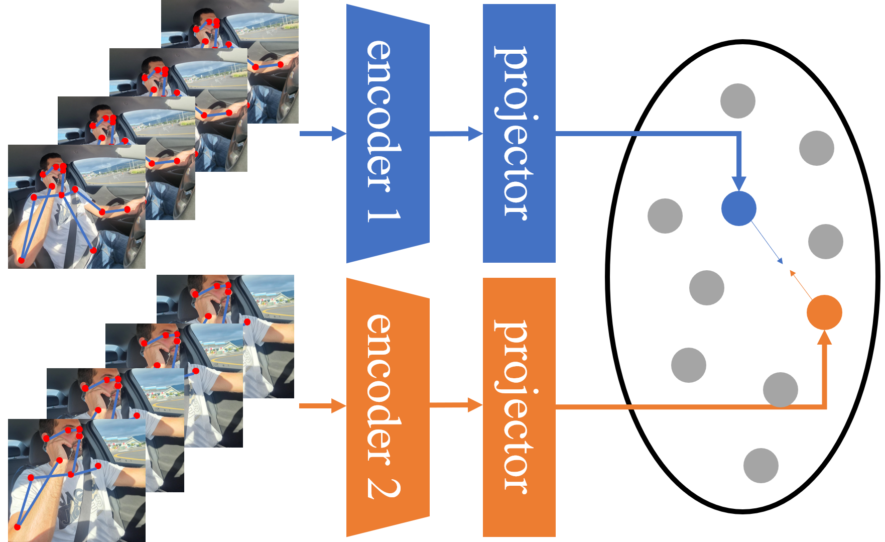
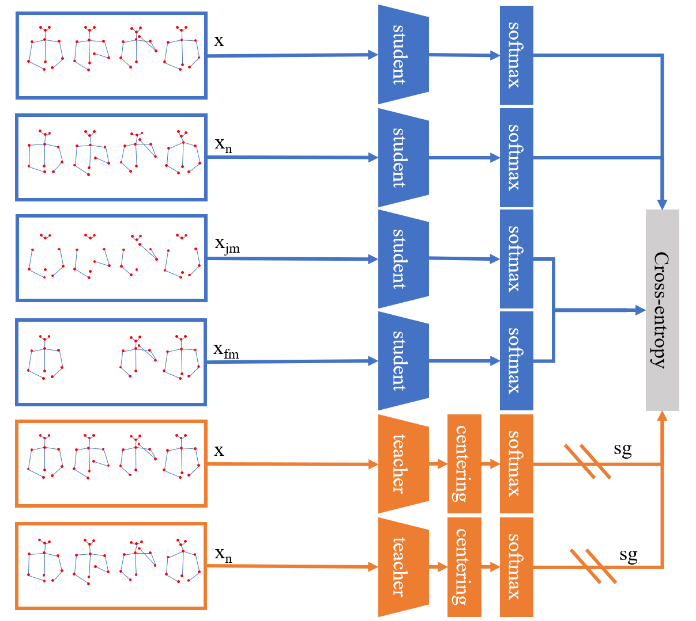
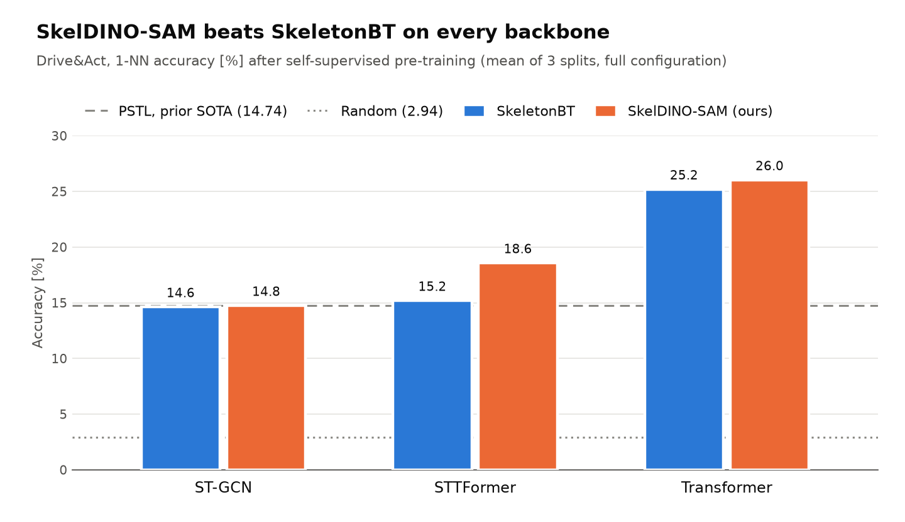
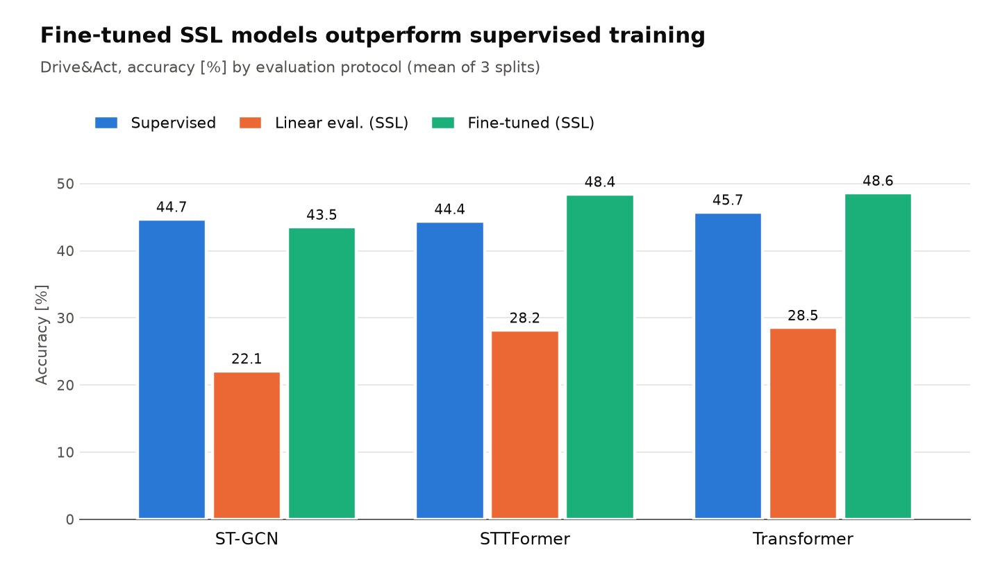
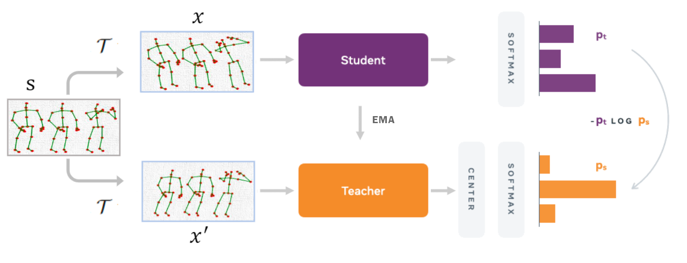
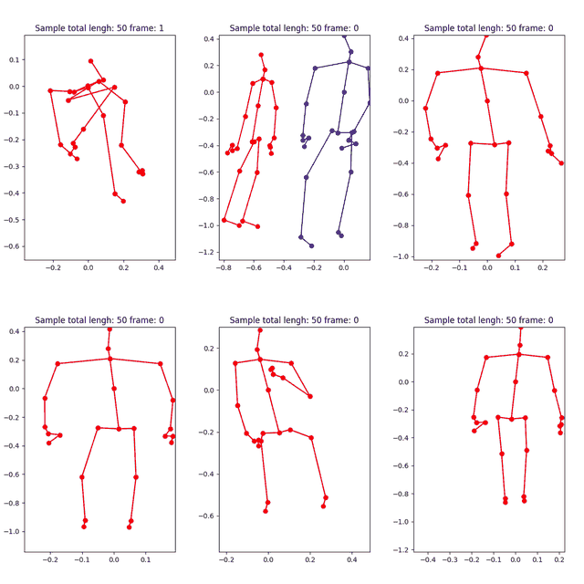
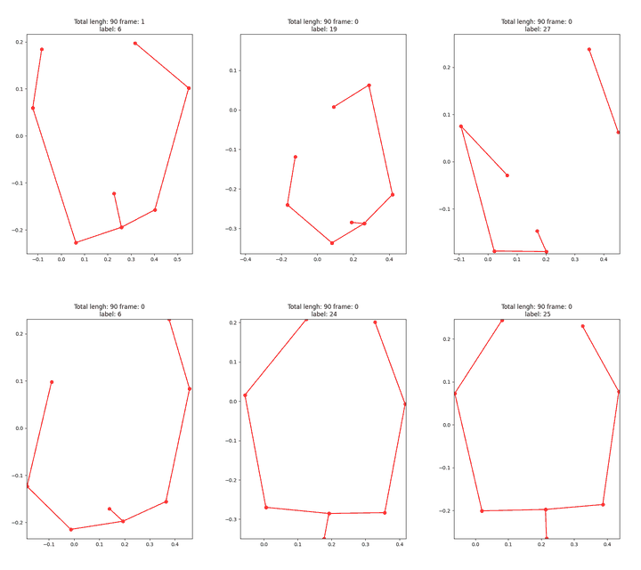
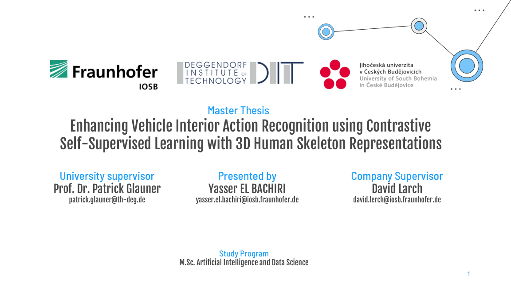

<div align="center">

# Self-Supervised 3D Skeleton-Based Driver Activity Recognition

**Master thesis (2023) and IEEE ITSC 2024 conference paper on learning driver activity representations from unlabeled 3D human skeletons**

[](https://doi.org/10.1109/ITSC58415.2024.10920160)
[](https://doi.org/10.1109/ITSC58415.2024.10920160)
[](thesis/El_Bachiri_2023_Master_Thesis.pdf)
[](https://github.com/davidjlerch/darssl)



<sub><i>Contrastive self-supervised learning without negative samples: two augmented views of the same driver skeleton sequence are pulled together in embedding space.</i></sub>

</div>

---

## Overview

Driver distraction is a major cause of road accidents, and detecting what the driver is doing inside the cabin usually requires models trained on large, expensively **labeled** datasets. This work asks how far we can get **without labels**, by pre-training on unlabeled 3D body-pose sequences with self-supervised learning (SSL) and only then using a small amount of supervision.

The project has two stages:

| | 🎓 **Master thesis** (Sep 2023) | 📄 **Conference paper** (ITSC 2024) |
|---|---|---|
| **Title** | *Enhancing Vehicle Interior Action Recognition using Contrastive Self-Supervised Learning with 3D Human Skeleton Representations* | *3D Skeleton-Based Driver Activity Recognition Using Self-Supervised Learning* |
| **Methods** | DINO + STTFormer, PSTL + ST-GCN | **SkelDINO-SAM** (ours) vs. SkeletonBT, across ST-GCN / STTFormer / Transformer |
| **Datasets** | NTU RGB+D 60, Drive&Act | Drive&Act |
| **Key result** | PSTL reproduction on par with SOTA on NTU-60 (76.8 / 82.6 % linear eval) | **+11.29 pp** over the prior state of the art (PSTL) on Drive&Act |
| **Files** | [PDF](thesis/El_Bachiri_2023_Master_Thesis.pdf) · [LaTeX](thesis/source) · [Abstract](thesis/El_Bachiri_2023_Master_Thesis_Abstract.pdf) · [Slides](slides/El_Bachiri_2023_Thesis_Defense_Slides.pdf) | [PDF](paper/Lerch_ElBachiri_ITSC2024_SkelDINO-SAM_author-version.pdf) · [DOI](https://doi.org/10.1109/ITSC58415.2024.10920160) · [LaTeX](paper/source) · [Code](https://github.com/davidjlerch/darssl) |

---

## 📄 ITSC 2024: SkelDINO-SAM

> **3D Skeleton-Based Driver Activity Recognition Using Self-Supervised Learning**<br>
> David J. Lerch, **Yasser El Bachiri**, Manuel Martin, Frederik Diederichs, Rainer Stiefelhagen<br>
> *27th IEEE International Conference on Intelligent Transportation Systems (ITSC), Edmonton, Canada, 2024*<br>
> 📄 [Author version (PDF)](paper/Lerch_ElBachiri_ITSC2024_SkelDINO-SAM_author-version.pdf) · 🔗 [IEEE Xplore](https://doi.org/10.1109/ITSC58415.2024.10920160)

### Method

**SkelDINO-SAM** adapts DINO-style self-distillation to 3D skeleton sequences. A **student** network sees the original sequence $x$, a noisy view $x_n$, a **frame-masked** view $x_{fm}$ and a **joint-masked** view $x_{jm}$. An exponential-moving-average **teacher** sees only the clean and noisy views. The student learns to match the teacher's centered output distribution, which forces it to recover the full action from partial, corrupted motion. On top of this, the training pipeline adds **class balancing**, **linear interpolation** of missing joints and **weighted masking**.

<div align="center">

</div>

### Results on Drive&Act

<picture>
  <source media="(prefers-color-scheme: dark)" srcset="assets/chart_1nn_dark.png">
  
</picture>

<picture>
  <source media="(prefers-color-scheme: dark)" srcset="assets/chart_protocols_dark.png">
  
</picture>

| Method | Backbone | 1-NN accuracy [%] |
|---|---|:---:|
| Random baseline | – | 2.94 |
| PSTL (prior SOTA) | ST-GCN | 14.74 |
| SkeletonBT | Transformer | 25.20 |
| **SkelDINO-SAM (ours)** | **Transformer** | **26.03** |

**Main findings**
- 🧠 **Transformer backbones win.** On average they are 9.6 pp better than ST-GCN and 8.3 pp better than STTFormer.
- ⚖️ **Every component helps.** Class balancing adds +1.35 pp, interpolation +0.38 pp (+1.65 pp with the Transformer) and weighted masking +0.17 pp.
- 🎯 **SSL pre-training pays off.** After fine-tuning, the SSL-pretrained STTFormer and Transformer **outperform their fully supervised counterparts**.
- 🔬 **Masking ablation.** The best result is **26.91 %**, with frame-mask p = 0.9 and joint-mask p = 0.7.

---

## 🎓 Master thesis

> **Enhancing Vehicle Interior Action Recognition using Contrastive Self-Supervised Learning with 3D Human Skeleton Representations**<br>
> **Yasser El Bachiri**. M.Sc. Artificial Intelligence and Data Science, Deggendorf Institute of Technology & University of South Bohemia, 2023.<br>
> Carried out at **Fraunhofer IOSB**, Karlsruhe. Supervisors: Prof. Dr. Patrick Glauner (DIT), David Lerch (Fraunhofer IOSB)

The thesis laid the groundwork for the paper. It compares two SSL families on 3D skeletons:
**DINO** (self-distillation, no negatives) with the transformer-based **STTFormer** encoder, and **PSTL** (contrastive) with the graph-based **ST-GCN** encoder. Both are evaluated on the large-scale **NTU RGB+D 60** benchmark and on the in-car **Drive&Act** dataset.

<div align="center">

<br><sub><i>DINO self-distillation applied to 3D skeleton sequences (thesis, Ch. 3 "Methodology").</i></sub>
</div>

<table>
<tr>
<td align="center" width="50%"><br><sub><b>NTU RGB+D 60</b>: full-body, 25-joint skeletons</sub></td>
<td align="center" width="50%"><br><sub><b>Drive&Act</b>: upper-body driver skeletons in the cabin</sub></td>
</tr>
</table>

### Key results

| Setting | Model | X-Sub | X-View |
|---|---|:---:|:---:|
| Supervised | ST-GCN | 81.5 % | 88.3 % |
| Supervised | STTFormer | 84.3 % | 94.3 % |
| SSL + linear evaluation | PSTL & ST-GCN (my implementation) | **76.8 %** | **82.6 %** |
| SSL + fine-tuning | PSTL & ST-GCN (my implementation) | **84.2 %** | **91.6 %** |
| SSL + k-NN | DINO & STTFormer | 23.0 % | 30.0 % |

<sub>NTU RGB+D 60. For reference, the published PSTL reaches 77.3 / 81.8 % and AimCLR 74.3 / 79.7 % under linear evaluation.</sub>

The thesis also found that **Drive&Act is much harder**: fine-grained, long-tailed classes and noisy upper-body poses gave single-digit k-NN accuracies. DINO training also proved hard to make converge. Both findings motivated the class balancing, interpolation and masking that became **SkelDINO-SAM** in the paper.

<div align="center">
<a href="slides/El_Bachiri_2023_Thesis_Defense_Slides.pdf"></a>
<br><sub><i>Thesis defense slides (38 pages). Click to open the PDF.</i></sub>
</div>

---

## 📁 Repository structure

```
.
├── paper/
│   ├── Lerch_ElBachiri_ITSC2024_SkelDINO-SAM_author-version.pdf
│   └── source/          # IEEE ITSC 2024 LaTeX source (ieeeconf, biblatex)
├── thesis/
│   ├── El_Bachiri_2023_Master_Thesis.pdf
│   ├── El_Bachiri_2023_Master_Thesis_Abstract.pdf
│   └── source/          # Thesis LaTeX source (KOMA-Script scrbook, BibTeX)
├── slides/
│   └── El_Bachiri_2023_Thesis_Defense_Slides.pdf
└── assets/              # README figures, charts and animations
```

Both LaTeX projects build cleanly from source with `latexmk`, [Tectonic](https://tectonic-typesetting.github.io/) or [Overleaf](https://www.overleaf.com/). See [`paper/README.md`](paper/README.md) and [`thesis/README.md`](thesis/README.md).

> **Code and data.** The implementation is published by the first author at **[github.com/davidjlerch/darssl](https://github.com/davidjlerch/darssl)**. Neither dataset is redistributed here. Request them from [NTU RGB+D](https://rose1.ntu.edu.sg/dataset/actionRecognition/) and [Drive&Act](https://driveandact.com/).

---

## 📚 Citation

```bibtex
@inproceedings{lerch2024skeldino,
  title     = {3D Skeleton-Based Driver Activity Recognition Using Self-Supervised Learning},
  author    = {Lerch, David J. and El Bachiri, Yasser and Martin, Manuel and Diederichs, Frederik and Stiefelhagen, Rainer},
  booktitle = {2024 IEEE 27th International Conference on Intelligent Transportation Systems (ITSC)},
  year      = {2024},
  doi       = {10.1109/ITSC58415.2024.10920160}
}

@mastersthesis{elbachiri2023thesis,
  title  = {Enhancing Vehicle Interior Action Recognition using Contrastive Self-Supervised Learning with 3D Human Skeleton Representations},
  author = {El Bachiri, Yasser},
  school = {Deggendorf Institute of Technology and University of South Bohemia},
  year   = {2023}
}
```

## 🙏 Acknowledgments

This research was carried out at **Fraunhofer IOSB** (Karlsruhe) in collaboration with the **Karlsruhe Institute of Technology (KIT)**, the **Deggendorf Institute of Technology (DIT)** and the **University of South Bohemia**. The paper was funded by the German Federal Ministry for Economic Affairs and Climate Action (BMWK) under funding codes 19A21031E, 19A21031F and 19A21031L, and by the European Union, within the project [KARLI](https://www.karli-projekt.de).

<sub>© 2024 IEEE. Personal use of this material is permitted. Permission from IEEE must be obtained for all other uses, in any current or future media, including reprinting/republishing this material for advertising or promotional purposes, creating new collective works, for resale or redistribution to servers or lists, or reuse of any copyrighted component of this work in other works. The definitive version is available at <a href="https://doi.org/10.1109/ITSC58415.2024.10920160">10.1109/ITSC58415.2024.10920160</a>.</sub>
